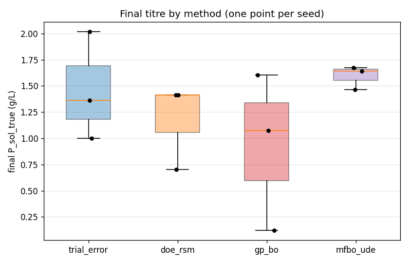
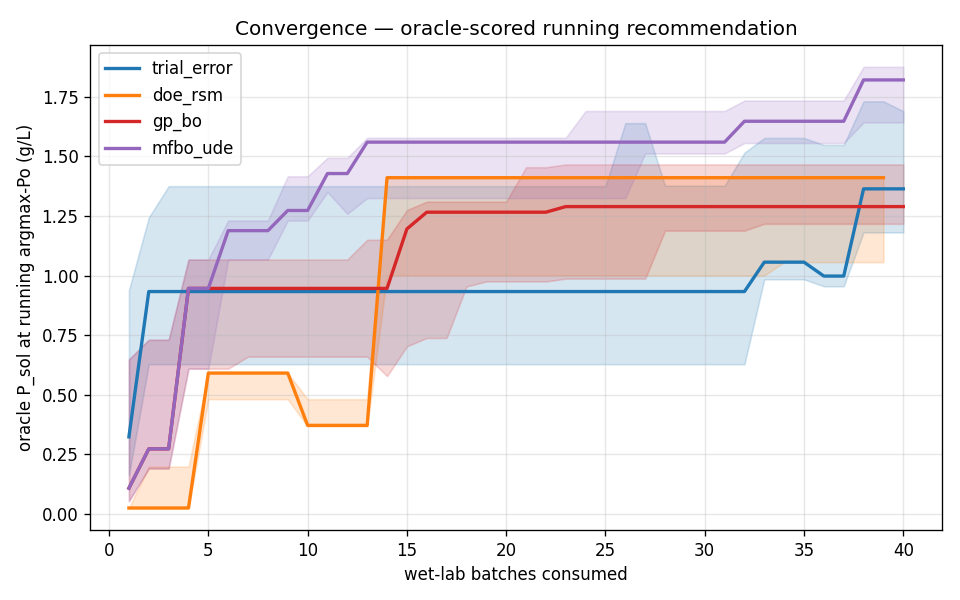

# Proinsulin fed-batch optimisation: model-based vs trial-and-error

How many wet-lab batches does it take to find a good operating point for a recombinant ***E. coli* fed-batch** producing **proinsulin**? This repo builds a mechanistic "proxy wet lab" and benchmarks five optimisation strategies against it on the same budget: trial-and-error, DoE / response surface, differential evolution on a simulator, Gaussian-process Bayesian optimisation, and **multi-fidelity Bayesian optimisation with a deliberately biased low-fidelity model plus a learned residual (UDE-style)**.

> **Context:** this started as my take-home assignment for **Lemnisca**'s interview process (the model-based optimisation part). All modelling, code and analysis here are my own work. The assignment brief and the workflow-review part of my answer are not included.



## Result

On identical seeds and a budget of about 40 simulated batches, the **multi-fidelity / UDE approach reaches the highest median titre (~1.64 g/L)** and converges fastest. Trial-and-error and DoE/RSM land at 1.36–1.41 g/L, and plain GP-BO trails at 1.07 g/L because it has no mechanistic prior to lean on within the budget. That is roughly **4× the naive baseline** (0.38 g/L) with the same kit, strain and media, and the model-based methods surface counter-intuitive choices such as an **interior IPTG optimum** rather than the bound.



## What's inside

| File | What it is |
|---|---|
| `wetlab_sim.py` | Ground-truth simulator: 9-state ODE (viable/dead biomass, glucose, acetate, soluble and inclusion-body product, DO, volume), per-run biological scatter, realistic online/offline measurement noise and assay delays, `run_batch()` as the single "wet-lab" call |
| `optimization.py` | The five methods sharing the same `run_batch` budget; `python optimization.py` runs the benchmark and writes `results.npz` |
| `diagnostics.py` | Figures in `plots/` (trajectory, convergence, comparison, sensitivity, best points, Pareto) |
| `sensitivity_surrogate_slices.py` | One-at-a-time sensitivity sweeps and a global response-surface check |
| `insulin_model.ipynb` | The model walkthrough notebook |
| `docs/MODEL.md` | Model equations, parameters and literature sources |
| `docs/OPTIMIZATION.md`, `docs/OPTIMIZATION_PROTOCOL.md` | Optimiser design, budgets and benchmark protocol |
| `docs/VARIABLE_SELECTION.md` | Which process variables enter the optimiser, and why |

Decision variables: production-phase temperature, IPTG dose, biomass at induction, feed rate and batch end time (with agitation, aeration and feed glucose as optional extensions).

## Quick start

```bash
pip install numpy scipy scikit-learn matplotlib
python optimization.py        # benchmark: all methods x seeds -> results.npz
python diagnostics.py         # figures -> plots/
```

The low-fidelity model in `optimization.py` is **intentionally biased** relative to the simulator (optimum temperature, induction kinetics, IPTG toxicity, kLa). That gap is the point of the multi-fidelity experiment.
